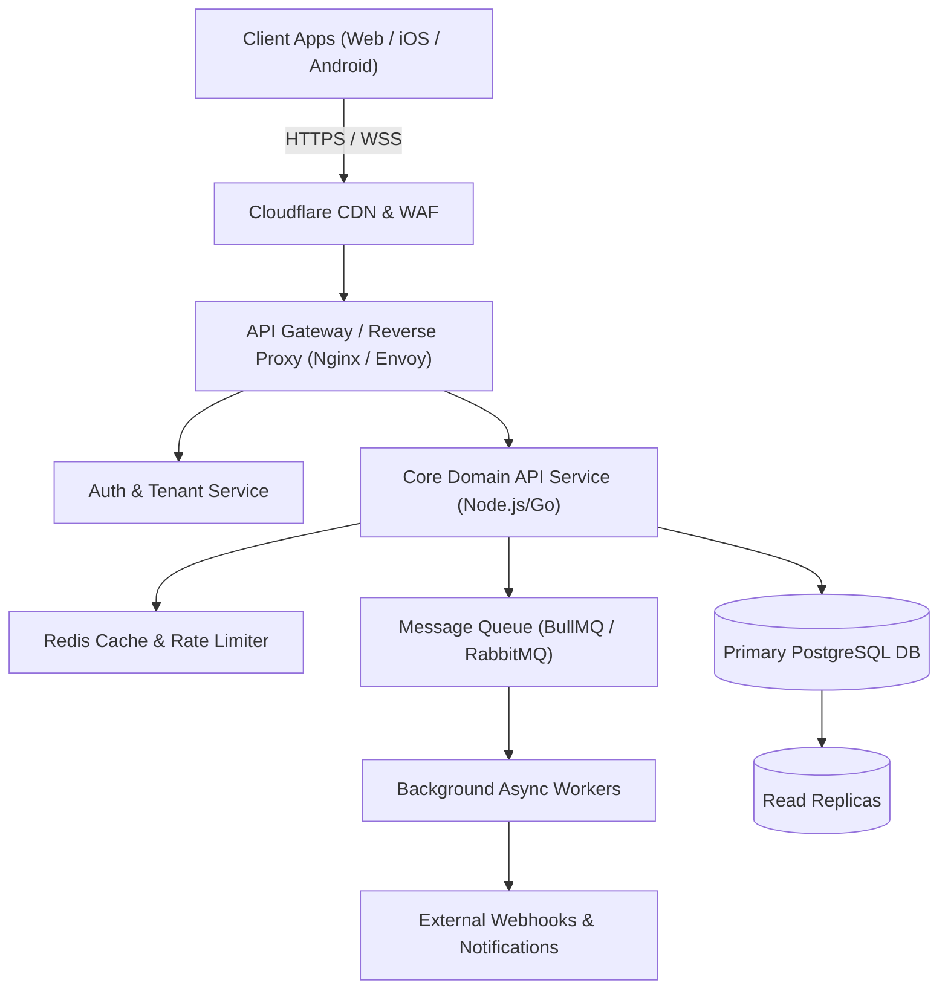

# 🏛️ System Architecture Blueprint: System Blueprint: Multi-tenant B2B analytics platform with real-time
*Generated by KromaDesk Principal System Architect Agent*
*Timestamp: 2026-10-25T06:55:23.095Z*

---

## 1. Executive Summary & Problem Breakdown
**Prompt / Concept:** Multi-tenant B2B analytics platform with real-time webhooks and billing tier quotas

**Architectural Rationale & Trade-offs:**
Relational PostgreSQL was selected over MongoDB to ensure strict ACID consistency, foreign key constraints, and relational integrity. Redis is leveraged as a write-through cache to keep P99 response times under 20ms.

---

## 2. High-Level C4 Topology (Mermaid Diagram)



---

## 3. Normalized Database Schema (PostgreSQL DDL)

```sql
-- Auto-Generated 3NF Schema by KromaDesk System Architect
CREATE EXTENSION IF NOT EXISTS "uuid-ossp";

CREATE TABLE accounts (
    id UUID PRIMARY KEY DEFAULT uuid_generate_v4(),
    email VARCHAR(255) UNIQUE NOT NULL,
    password_hash VARCHAR(255) NOT NULL,
    plan_tier VARCHAR(50) DEFAULT 'starter',
    created_at TIMESTAMPTZ DEFAULT NOW(),
    updated_at TIMESTAMPTZ DEFAULT NOW()
);

CREATE TABLE workspaces (
    id UUID PRIMARY KEY DEFAULT uuid_generate_v4(),
    account_id UUID REFERENCES accounts(id) ON DELETE CASCADE,
    name VARCHAR(100) NOT NULL,
    slug VARCHAR(100) UNIQUE NOT NULL,
    created_at TIMESTAMPTZ DEFAULT NOW()
);

CREATE TABLE core_entities (
    id UUID PRIMARY KEY DEFAULT uuid_generate_v4(),
    workspace_id UUID REFERENCES workspaces(id) ON DELETE CASCADE,
    title VARCHAR(255) NOT NULL,
    payload JSONB DEFAULT '{}'::jsonb,
    status VARCHAR(50) DEFAULT 'active',
    created_at TIMESTAMPTZ DEFAULT NOW(),
    updated_at TIMESTAMPTZ DEFAULT NOW()
);

CREATE INDEX idx_workspaces_account ON workspaces(account_id);
CREATE INDEX idx_core_entities_workspace ON core_entities(workspace_id, status);
CREATE INDEX idx_core_entities_payload_gin ON core_entities USING gin (payload);
```

---

## 4. API Contract & Data Payloads

| Method | Endpoint | Description |
| :--- | :--- | :--- |
| `POST` | `/api/v1/auth/register` | Registers account & generates JWT session |
| `GET` | `/api/v1/entities` | Lists domain entities with cursor pagination |
| `POST` | `/api/v1/entities` | Creates a new domain entity and enqueues event |

### Sample Payloads:
#### `POST /api/v1/auth/register`
**Request:**
```json
{
  "email": "user@example.com",
  "password": "SecurePassword123"
}
```
**Response:**
```json
{
  "token": "jwt_...",
  "user_id": "uuid"
}
```

#### `GET /api/v1/entities`
**Request:**
```json
{}
```
**Response:**
```json
{
  "items": [],
  "next_cursor": "cur_..."
}
```

#### `POST /api/v1/entities`
**Request:**
```json
{
  "title": "Item Name",
  "payload": {}
}
```
**Response:**
```json
{
  "id": "uuid",
  "status": "queued"
}
```

---

## 5. Background Jobs & Asynchronous Message Queues

| Queue Name | Purpose | Trigger Strategy |
| :--- | :--- | :--- |
| `async-notifications` | Dispatches transactional emails & push notifications | Event driven |
| `data-aggregation` | Rolls up analytics and syncs search indexes | Every 10 minutes |

---

## 6. Scalability, Infrastructure & Cost Roadmap

* **Stage 1 (Day 1 – 1,000 Users):**
  Single containerized API node + Managed PostgreSQL (Supabase / RDS t4g.small) + Redis. Total infrastructure cost ~$35/mo.

* **Stage 2 (10,000 – 100,000 Users):**
  Horizontal pod autoscaling (HPA) on K8s or ECS, PostgreSQL Read Replicas with PgBouncer connection pooling, Redis caching for hot entities. Cost ~$250/mo.

* **Stage 3 (1,000,000+ Users):**
  Multi-region CDN edge caching, Kafka event streaming for real-time state, table partitioning by workspace_id/tenant_id, Elasticsearch for search.

---
*Ready to hand off to KromaDesk Backend Dev and Frontend Dev Agents for execution.*
